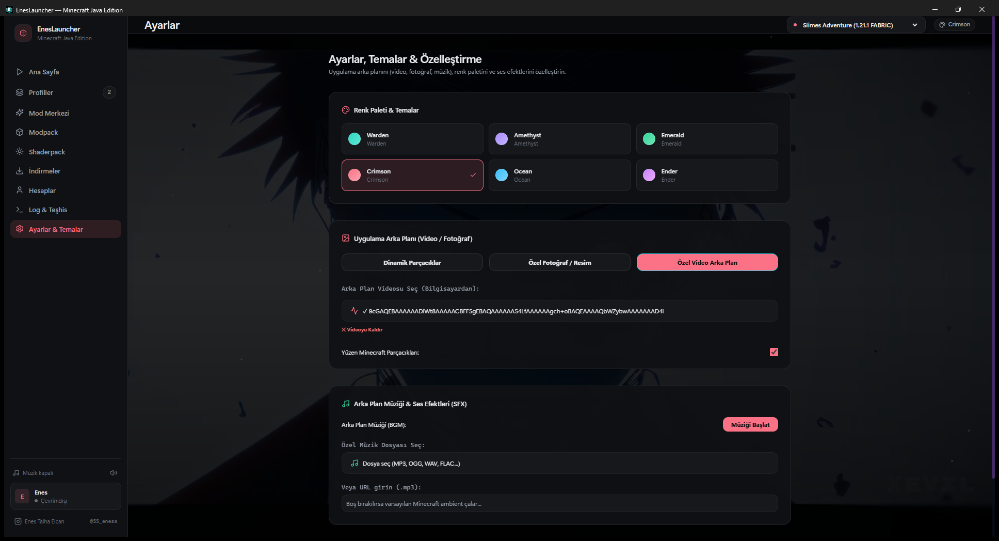
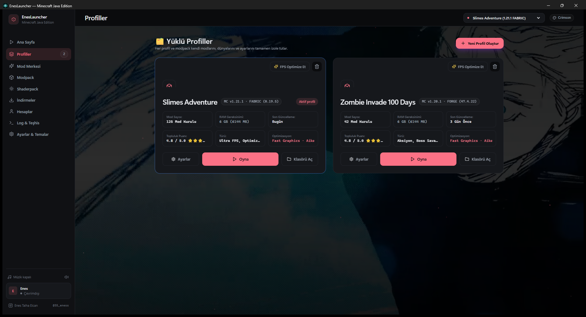
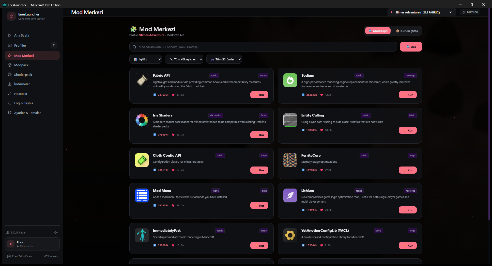
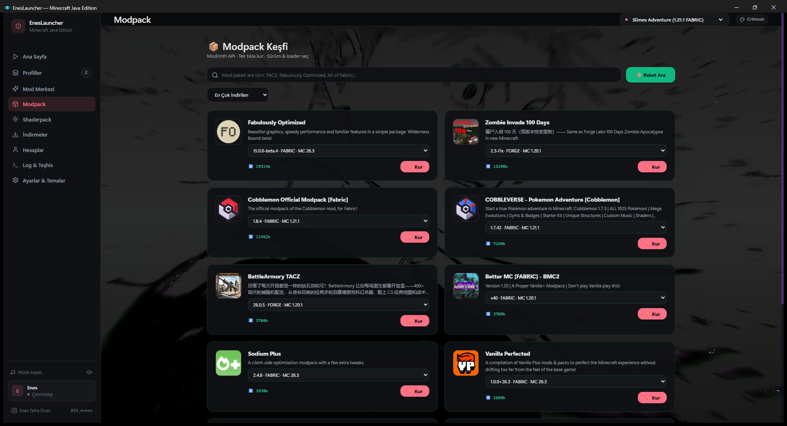
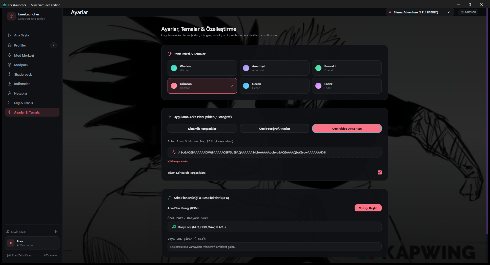

# EnesLauncher

Windows için modern bir **Minecraft: Java Edition** başlatıcısı. Tauri 2 (Rust) çekirdeği + React arayüzü.
Mod kurulumu, modpack yönetimi, çoklu profil, Microsoft hesabı ve otomatik Java bulma tek yerde.


## Ekran görüntüleri

| Ana Sayfa | Profiller |
|---|---|
|  |  |

| Mod Merkezi | Modpack Keşfi |
|---|---|
|  |  |

### Ayarlar, Temalar & Özelleştirme



---

## Özellikler

| Alan | Ne yapıyor |
|---|---|
| **Hesaplar** | Microsoft (cihaz kodu akışı) ve çevrimdışı hesap. Token'lar **Windows Credential Manager**'da tutulur, diske yazılmaz. |
| **Profiller** | Sürüm + loader bazlı ayrı instance'lar, RAM ayarı, dil, özel arka plan. |
| **Loader desteği** | Vanilla, Fabric, Forge, NeoForge, Quilt. |
| **İndirme** | Mojang Piston metadata, kütüphane/asset indirme, SHA-1 doğrulama, paralel indirme (8 eşzamanlı). |
| **Modlar** | Modrinth üzerinden arama, mod / modpack / shader kurulumu, aç-kapa, silme. |
| **Modpack** | `.mrpack` içe ve dışa aktarma, zip-slip korumalı arşiv açma. |
| **Java** | `JAVA_HOME`, `PATH`, Program Files, `%LOCALAPPDATA%\Programs` ve Minecraft'ın kendi runtime klasörlerini tarar; sürüm ve 64-bit kontrolü yapar. |
| **Crash analizi** | `latest.log` / `debug.log` okuyup bilinen hata kalıplarını Türkçe açıklar. |
| **Kalıcılık** | SQLite (rusqlite, bundled) — harici kurulum gerekmez. |

---

## Gereksinimler

**Kullanıcı için**
- Windows 10 (1803+) veya Windows 11, x64
- [WebView2 Runtime](https://developer.microsoft.com/microsoft-edge/webview2/) — Windows 11'de hazır gelir
- Java 17+ (launcher kurulu Java'yı otomatik bulur; yoksa uyarır)

**Geliştirme için**
- [Rust](https://rustup.rs/) (stable, `x86_64-pc-windows-msvc`)
- Visual Studio Build Tools — "Desktop development with C++" (MSVC linker)
- [Node.js](https://nodejs.org/) 20+

---

## Hızlı başlangıç

```powershell
git clone https://github.com/<kullanici>/EnesLauncher.git
cd EnesLauncher

# arayüz bağımlılıkları (bir kez)
cd apps\desktop
npm ci
cd ..\..

# derle + çalıştır
.\build.ps1 -Run
```

Sonuç: `EnesLauncher-App\EnesLauncher.exe` (proje klasörünün bir üstünde) ve masaüstünde kısayol.

### Geliştirme modu

```powershell
cd apps\desktop
npm run tauri dev
```

### Derleme seçenekleri

| Komut | Ne yapar |
|---|---|
| `.\build.ps1` | Release derler, sabit exe'yi günceller, kısayolu yeniler |
| `.\build.ps1 -Run` | Derledikten sonra açar |
| `.\build.ps1 -Dev` | Debug derler (hızlı derleme, yavaş çalışma) |
| `.\build.ps1 -SkipFrontend` | Arayüz değişmediyse `npm run build` adımını atlar |
| `.\build.ps1 -NoShortcut` | Masaüstü kısayoluna dokunmaz |

### Disk temizliği

Rust derlemeleri büyür. Cache'i şişirmeden tutmak için:

```powershell
.\temizle.ps1              # 14 günden eski artefaktları siler
.\temizle.ps1 -Incremental # sadece incremental önbelleği
.\temizle.ps1 -Hepsi       # tüm cache (sonraki derleme sıfırdan)
```

`temizle.ps1` sabit exe'ye dokunmaz.

---

## Proje yapısı

```
EnesLauncher/
├─ apps/desktop/              React + Vite arayüzü
│  └─ src-tauri/              Tauri kabuğu (main.rs, tauri.conf.json, ikonlar)
├─ crates/
│  ├─ launcher-core           Ortak tipler, hata modeli, dizin yolları
│  ├─ archive-security         Zip-slip / path traversal koruması
│  ├─ persistence             SQLite katmanı
│  ├─ minecraft-metadata      Mojang Piston istemcisi
│  ├─ download-engine         Paralel indirme + hash doğrulama
│  ├─ java-locator            Java bulma ve sürüm tespiti
│  ├─ launch-service          Oyun sürecini kurma ve başlatma
│  ├─ loader-adapters         Fabric / Forge / NeoForge / Quilt
│  ├─ mod-provider-api        Sağlayıcı trait'i
│  ├─ modrinth-provider       Modrinth istemcisi
│  ├─ instance-manager        Profil oluşturma / silme / ayar
│  ├─ modpack-engine          .mrpack içe-dışa aktarma
│  ├─ crash-analyzer          Log okuma ve teşhis
│  └─ auth-service            Microsoft + çevrimdışı hesaplar
├─ build.ps1                  Derleme + sabit exe
├─ temizle.ps1                Cache bakımı
└─ Cargo.toml                 Workspace + profil ayarları
```

### Veri konumları

| Ne | Nerede |
|---|---|
| Profiller, kütüphaneler, modlar | `%LOCALAPPDATA%\eneslauncher\EnesLauncher\data\` |
| Veritabanı | `...\data\launcher.sqlite` |
| Log (tek dosya, 512 KB'ta sıfırlanır) | `...\data\logs\launcher.log` |
| Hesap token'ları | Windows Credential Manager |

> `data\instances` ve `data\shared` **oyun verisidir**, log değil. Yer açmak için
> launcher arayüzünden kullanılmayan profilleri silin.

---

## Derleme profilleri

`Cargo.toml` içinde boyut/hız dengesi için:

```toml
[profile.dev]
debug = "line-tables-only"   # tam sembol yerine satır bilgisi

[profile.dev.package."*"]
debug = false                # bağımlılıklar sembolsüz → rlib'ler %60-70 küçük
opt-level = 1

[profile.release]
lto = "thin"
strip = "symbols"
panic = "abort"
```

Bu ayarlar olmadan bir Tauri debug derlemesi Windows'ta 15 GB'a kadar çıkabilir
(`libwindows.rlib` tek başına ~117 MB, PDB ~175 MB). Bu profillerle aynı proje
~1,5 GB'ta kalır.

---

## GitHub Actions

`.github/workflows/build.yml` her push'ta Windows üzerinde derler ve test eder;
etiket (`v*`) push edildiğinde exe'yi Release'e ekler.

```powershell
git tag v0.1.0
git push origin v0.1.0
```

---

## Bilinen sınırlar

- Yalnızca Windows hedeflenir (Credential Manager, WebView2, kayıt defteri).
- Forge/NeoForge kurulumu indirme + yama adımlarına dayanır; her sürüm kombinasyonu test edilmemiştir.
- Arayüz Türkçe ağırlıklı; dil altyapısı profil bazında mevcuttur.

## Katkı

Issue ve PR'lar açık. Büyük değişikliklerden önce bir issue açıp yaklaşımı konuşalım.
Kod tarzı: `cargo fmt` + `cargo clippy` uyarısız.

## Lisans

[MIT](LICENSE)

---

<sub>Bu proje Mojang Studios, Microsoft veya Modrinth ile bağlantılı değildir.
"Minecraft" Mojang Studios'un ticari markasıdır.</sub>
